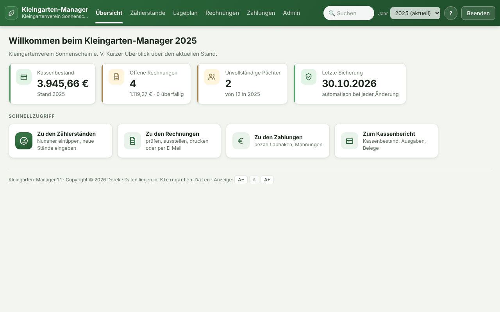
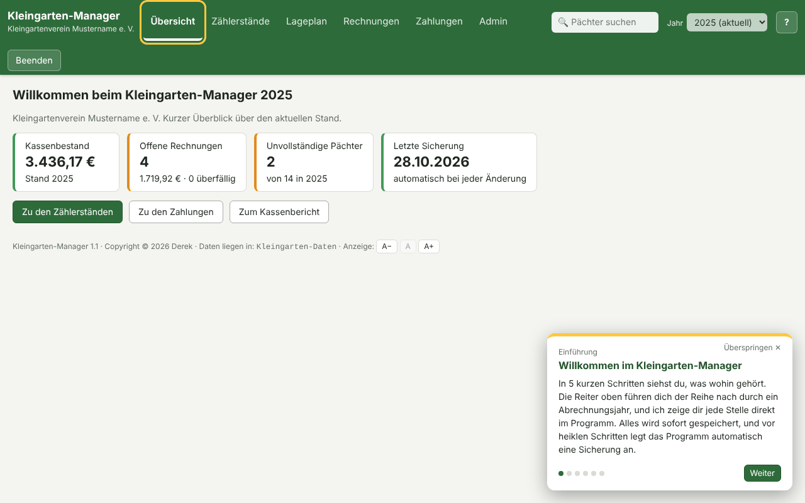
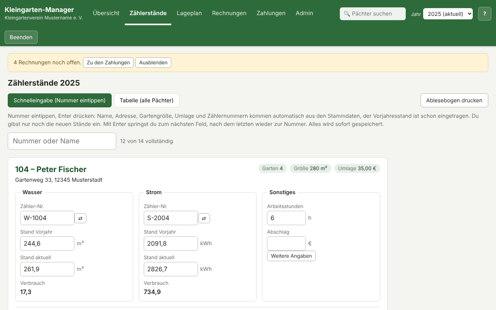
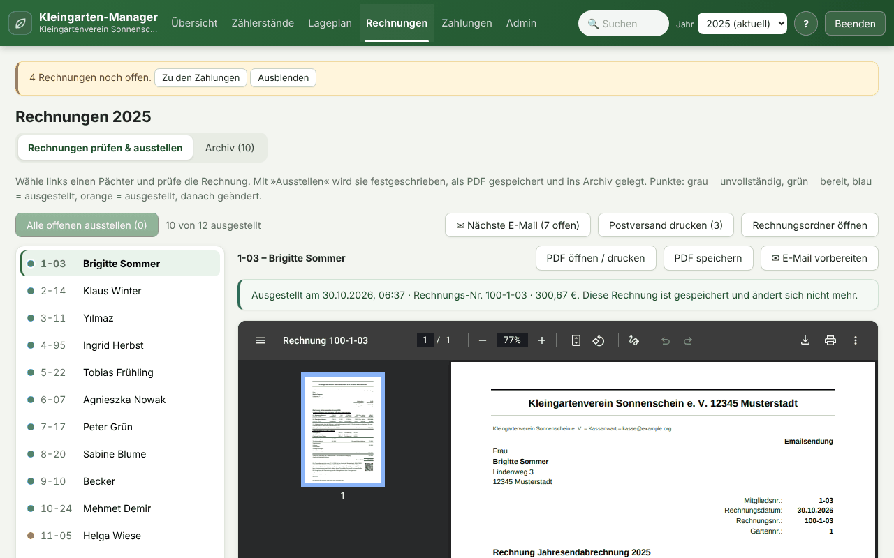
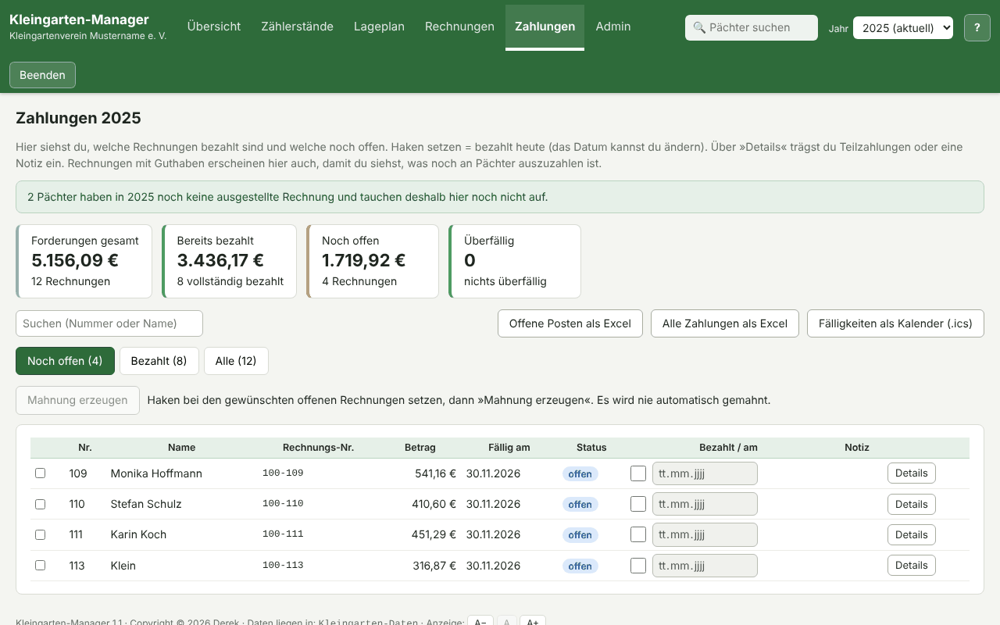
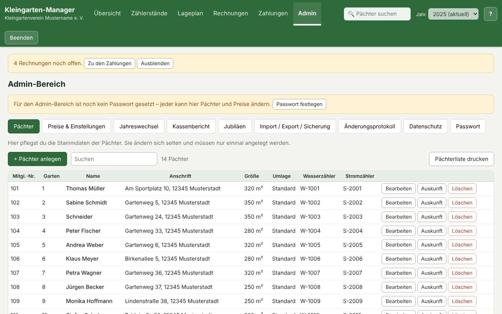
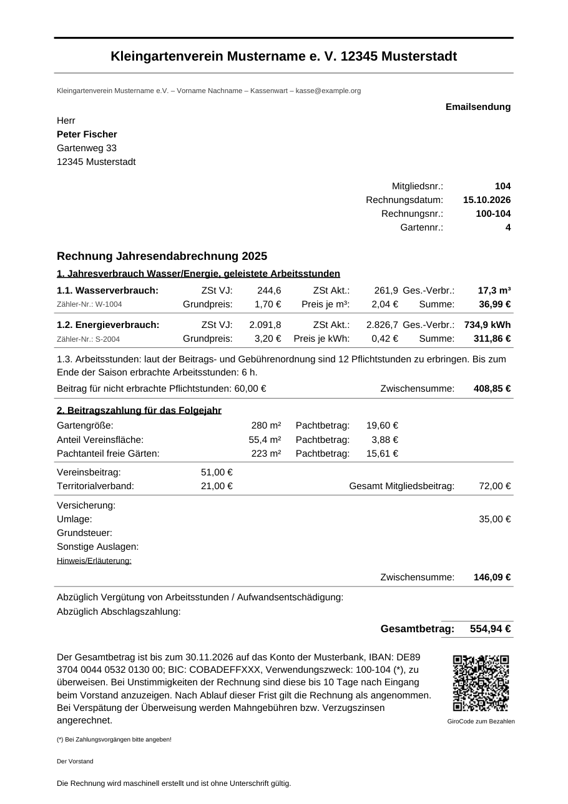

# Kleingarten-Manager

**Die Jahresabrechnung für euren Kleingartenverein.** Pächter einmal anlegen, jedes Jahr nur noch die
Zählerstände eintragen – die Rechnungen kommen fertig als PDF heraus, mit QR-Code zum Bezahlen.

### [⬇ Zum Download (Windows und macOS)](https://github.com/Magnethelm90/Kleingarten-Manager/releases/latest)

- **Kostenlos**, ohne Anmeldung und ohne Abo
- **Keine Installation:** eine Datei herunterladen und doppelklicken
- **Eure Daten bleiben bei euch:** alles liegt auf dem eigenen Rechner, nichts wird ins Internet gesendet
- **Für Vorstand und Kassenwart gemacht:** Zählerstände, Rechnungen, Zahlungen, Mahnungen, Kassenbericht,
  Jahreswechsel, Pächterliste und Ablesebogen zum Ausdrucken
- **Mit Einführung:** beim ersten Start zeigt ein kurzer Rundgang, was wohin gehört
- **Erst ausprobieren:** auf Knopfdruck mit einem erfundenen Beispielverein, der sich danach mit einem Klick wieder entfernen lässt

## So sieht es aus



| | |
| --- | --- |
|  |  |
| **Einführung** beim ersten Start – fünf kurze Schritte | **Zählerstände:** Nummer eintippen, nur die neuen Stände eingeben |
|  |  |
| **Rechnungen** prüfen und mit einem Klick für alle ausstellen | **Zahlungen** abhaken, offene Posten und Mahnungen |
|  |  |
| **Pächter** einmal anlegen oder aus Excel übernehmen | **Die fertige Rechnung** als PDF, mit GiroCode zum Bezahlen |

<sub>Alle Namen und Zahlen in den Bildern sind erfunden.</sub>

## In drei Schritten zur ersten Rechnung

1. **Herunterladen und starten:** Die Datei aus dem [Download](https://github.com/Magnethelm90/Kleingarten-Manager/releases/latest)
   in einen eigenen Ordner legen und doppelklicken. Windows zeigt beim ersten Start eventuell
   „Der Computer wurde durch Windows geschützt“, weil das Programm nicht kostenpflichtig signiert ist:
   auf **Weitere Informationen → Trotzdem ausführen** klicken.
2. **Einrichten:** unter *Admin → Preise & Einstellungen* Verein, Preise und Bankverbindung eintragen und
   die Pächter anlegen (oder eine vorhandene Excel-Liste importieren).
3. **Abrechnen:** unter *Zählerstände* die neuen Stände eingeben, dann unter *Rechnungen* auf
   „Alle offenen ausstellen“ – fertig sind die PDFs zum Mailen oder Ausdrucken.

## Über das Programm

Kleines Programm für Kleingartenvereine (Windows und macOS): Pächter einmal anlegen, jedes Jahr nur noch die
Zählerstände eintragen, daraus werden die Rechnungen als PDF erzeugt. Daneben auch Lageplan, Kassenbericht mit
Kassenprüfer-Zugang, Mahnungen und mehr – daher der Name: es ist inzwischen mehr als reine Abrechnung
(früher hieß das Programm „Gartenabrechnung“).

Unter Windows ist das Programm eine einzelne `.exe` ohne Installation, unter macOS eine normale `.app` zum
Reinziehen in den Programme-Ordner. Es läuft in einem eigenen Programmfenster (kein Browser-Tab, keine
Adressleiste) und startet dafür im Hintergrund einen kleinen Webserver, der **nur auf dem eigenen Rechner**
(`127.0.0.1`) lauscht. Es werden keine Daten ins Internet gesendet, es gibt keine Konten, Schlüssel oder
Cloud-Anbindung.

## Funktionen

- **Übersicht:** Startseite mit Kennzahlen auf einen Blick – Kassenbestand, offene Rechnungen, unvollständige
  Pächter, Datum der letzten Sicherung; erinnert, wenn noch kein zweiter Sicherungsordner (USB-Stick) eingerichtet
  ist oder die letzte Kopie dort älter als 30 Tage ist
- **Jahresfortschritt:** auf der Übersicht in vier Stationen (Zählerstände, Rechnungen, Zahlungen, Jahresabschluss),
  mit Balken und einem Knopf zum nächsten Schritt
- **Vereinsfarbe und Logo** (Admin → Preise & Einstellungen): eigene Farbe und Vereinslogo für Programm, Rechnung und
  Mahnung; zu helle Farben werden automatisch so abgedunkelt, dass alles lesbar bleibt
- **»Gut lesbar«** (unten neben der Schriftgröße): kräftigere Schrift, stärkere Kontraste, größere Knöpfe
- **Beispieldaten:** solange noch nichts eingegeben ist, lässt sich ein erfundener Verein mit 12 Pächtern,
  Zählerständen und Kassenbuchungen laden, um alles gefahrlos auszuprobieren; »Beispieldaten entfernen« setzt das
  Programm danach wieder auf den Anfang zurück
- **Einführung im Programm:** beim ersten Start führt ein kurzer Rundgang in 5 Schritten durch das Programm (einrichten,
  Zählerstände, Rechnungen, Zahlungen, Jahresabschluss). Jeder Schritt wechselt selbst zur passenden Stelle und
  markiert den Reiter; über den runden »?«-Knopf oben rechts lässt er sich jederzeit wieder aufrufen
- **Datenschutz (DSGVO-Hilfen):** Admin → Datenschutz: Auskunft und Datenkopie je Person als Datei (Art. 15/20),
  endgültiges Löschen entfernt den Personenbezug auch aus Protokoll, Garten-Historie und allen Sicherungen (Art. 17),
  nach Ablauf der Aufbewahrungsfrist lassen sich Rechnungen und Jahresunterlagen bereinigen. Vorlagen für
  Verarbeitungsverzeichnis und Mitgliederinformation: [DATENSCHUTZ.md](DATENSCHUTZ.md)
- **Globale Suche:** Suchfeld im Kopfbereich, von jeder Seite aus erreichbar – Name, Gartennummer, Mitgliedsnummer
  oder Straße eingeben, springt direkt zur Schnellansicht des passenden Pächters
- **Admin-Bereich:** Pächter anlegen, ändern, löschen (Nummer, Name, Anschrift, E-Mail, Telefon, Gartengröße, Umlage, Zählernummern),
  Preise und Regeln einstellen (Wasser, Strom, Pacht, Arbeitsstunden, Bankverbindung, Rechnungsdatum), optionales Passwort.
  Gelöschte Pächter landen im Papierkorb (Zählerstände und Rechnungen bleiben erhalten) und lassen sich
  wiederherstellen oder endgültig entfernen
- **Pächterwechsel** (Admin → Pächter → »Wechsel«): führt in einem Schritt durch die Gartenübergabe – Übergabetag,
  gemeinsam abgelesene Zählerstände, Arbeitsstunden, neuer Pächter (auf Wunsch direkt von der Warteliste),
  Ablösesumme, Schlüssel und Zustand. Der bisherige Pächter bekommt eine **Schlussrechnung** über den Verbrauch bis
  zur Übergabe (ohne Pacht und Beiträge fürs Folgejahr), der neue startet mit den Übergabeständen. Dazu gibt es ein
  **Übergabeprotokoll** als PDF mit Checkliste und Unterschriftsfeldern. Der bisherige Pächter bleibt bis zum
  Jahreswechsel für seine Schlussrechnung sichtbar und kommt dann von selbst in den Papierkorb
- **Warteliste** (Admin → Warteliste): Interessenten mit Anmeldedatum, Kontakt und Wunsch, in der Reihenfolge der
  Anmeldung; »Garten vergeben« startet den Pächterwechsel mit den Angaben des Interessenten. Wer seit über 2 Jahren
  nicht nachgefragt wurde, wird markiert; gelöschte Einträge verschwinden auch aus den Sicherungen
- **Vereinstermine** (Reiter »Termine«): Jahresplaner für Arbeitseinsätze, Versammlungen, Ablesung und Feste, als
  Aushang zum Drucken und als Kalenderdatei fürs Handy; die Termine eines Jahres lassen sich mit einem Klick ins
  nächste übernehmen (auf denselben Wochentag), die nächsten Termine stehen auch auf der Übersicht
- **Schnelleingabe:** Nummer eintippen, Stammdaten und Vorjahresstände erscheinen automatisch, nur neue Zählerstände eingeben
- **Ablesebogen:** Liste aller Gärten mit Zählernummern, Vorjahresständen und leeren Feldern zum Ausdrucken für den
  Ablese-Rundgang (A4 quer, nach Gartennummer sortiert)
- **Pächterliste:** Garten, Name, Anschrift, Größe, Versandart, Telefon/E-Mail und Zähler aller Pächter als PDF zum Ausdrucken (nur mit
  Admin-Zugang, Admin → Pächter)
- **Rechnungen:** PDF pro Pächter oder alle auf einmal, ausgestellte Rechnungen werden mit den damaligen Werten
  festgeschrieben und archiviert (spätere Änderungen verändern sie nicht); das Archiv lässt sich auch über alle
  Jahre hinweg durchsuchen (z. B. „wann wurde dieser Pächter zuletzt abgerechnet“)
- **Drucken für den Postversand:** »Postversand drucken« fasst alle ausgestellten Rechnungen mit Versandart Postversand
  in einer PDF-Datei zusammen (nach Mitgliedsnummer sortiert, jede Seite mit ihrem eigenen GiroCode); im Programmfenster
  öffnet »Im PDF-Programm öffnen« die Rechnung bzw. die Sammeldatei im PDF-Programm des Rechners
- **Rechnung per E-Mail vorbereiten:** öffnet das E-Mail-Programm des Rechners mit Empfänger, Betreff und fertigem
  Text (Betrag, Zahlungsziel, Konto, Verwendungszweck) und markiert die PDF-Datei im Ordner, sie muss nur noch
  angehängt werden; »Nächste E-Mail« arbeitet alle Rechnungen mit Versandart Emailsendung der Reihe nach ab.
  Das Programm verschickt selbst nichts und braucht keine Zugangsdaten zum Mailkonto
- **Zahlungen:** bezahlt abhaken (mit Datum), Teilzahlungen, Liste der offenen Posten, Excel-Export
- **GiroCode auf der Rechnung:** QR-Code zum Bezahlen, die Banking-App füllt IBAN, Betrag und Verwendungszweck
  automatisch aus
- **Zählerwechsel:** wird ein Zähler unterjährig getauscht, wird der Verbrauch aus dem Endstand des alten und
  dem Anfangsstand des neuen Zählers richtig zusammengerechnet, die neue Zählernummer wandert automatisch in
  die Stammdaten
- **Jahresverlauf:** Wasser-, Stromverbrauch, Arbeitsstunden und Gesamtbetrag der Vorjahre pro Pächter auf einen Blick
- **Hinweise bei ungewöhnlichem Verbrauch:** fällt der eingetragene Wasser- oder Stromverbrauch deutlich aus dem Rahmen
  (z. B. Tippfehler beim Zählerstand), erscheint ein Hinweis – die Eingabe wird dadurch nicht blockiert
- **Notizfeld je Pächter:** interner Vermerk (z. B. „Tochter kümmert sich, Tel. …“), steht nirgends auf der Rechnung
- **Kassenbericht** (Admin-Bereich, eigene Jahresauswahl): fasst die Abrechnung aller Pächter zusammen, vergleicht
  Wasser- und Stromverbrauch mit der Rechnung des Versorgers, verwaltet sonstige Ausgaben der Vereinskasse
  (Kontoführung, Anschaffungen, Reparaturen – jede Ausgabe einzeln, mit Kategorie, optional mehreren Beleg-Fotos/PDFs
  (z. B. Vorder- und Rückseite einer Quittung) und Kassenprüfer-Haken, optional als jährlich wiederkehrend
  markierbar – wird dann beim Jahreswechsel automatisch als Vorschlag fürs neue Jahr übernommen, z. B.
  Kontoführungsgebühren) und führt mit einem Anfangsbestand einen
  echten Kassenbestand (wird beim Jahreswechsel automatisch fortgeschrieben; ändert sich der Vorjahresbestand
  danach noch, z. B. durch eine späte Zahlung, weist der Kassenbericht darauf hin); dazu ein Verlauf über die Jahre für
  den Verein insgesamt; als Excel-Datei für die Kassenprüfung exportierbar
- Beim Öffnen ein Hinweis, wenn noch Rechnungen offen oder überfällig sind
- **Jahreswechsel**, Import der Mitglieder aus Excel/CSV, Excel-Export, automatische Sicherungen
- **Lageplan:** alle Gärten mit Status-Farbcode (unvollständig/berechnet/offen/bezahlt), Klick auf einen Garten
  springt direkt zur Schnelleingabe dieses Pächters; im Admin-Bereich lassen sich die Gärten per Maus so anordnen,
  wie sie auf dem Gelände liegen. Gärten ohne Pächter erscheinen gestrichelt als **frei**, mit Hinweis auf die
  Warteliste; ein Klick vergibt den Garten direkt an jemanden von der Warteliste. **Drucken** liefert den Lageplan als
  Aushang (ohne Namen und ohne Abrechnungsstand) oder für den Vorstand mit Namen
- **Jahresbericht** (Admin → Kassenbericht oder Jahreswechsel): ein PDF für die Mitgliederversammlung mit Kennzahlen
  und Vorjahresvergleich (Gärten, Wasser, Strom, Gemeinschaftsarbeit, Rechnungssumme, Zahlungseingang), Kasse,
  Ausgaben nach Art, Kassenbestand im Verlauf als Diagramm, Vereinsleben (Gartenübergaben, Warteliste, Pflichtstunden)
  und den nächsten Terminen – ohne Namen, kann also ausgelegt oder an die Wand geworfen werden
- **Zahlungserinnerung (Mahnung):** bei den Zahlungen gezielt offene Rechnungen anhaken und eine Mahnung als PDF
  erzeugen (mit GiroCode); es wird nie automatisch nach einer festen Frist gemahnt, immer nur die ausgewählten
- **Zweiter Sicherungsordner** (optional, frei wählbarer Pfad, z. B. USB-Stick oder Netzlaufwerk): Sicherungen
  werden zusätzlich dorthin gespiegelt und dort wie im Hauptordner aufgeräumt; nicht erreichbar (Stick nicht
  eingesteckt) ⇒ das Programm läuft normal weiter, erinnert in der Übersicht und holt die Kopie nach (oder sofort
  per »Jetzt sichern«)
- **Änderungsprotokoll:** hält fest, wann welcher Pächter oder welche Preise geändert wurden (Zeitpunkt und Art
  der Änderung; es gibt nur ein gemeinsames Admin-Passwort, daher keine Zuordnung zu einer Person)
- **Kassenprüfer-Zugang:** eigenes, optionales Passwort mit Lesezugriff auf den Kassenbericht (inkl.
  Geprüft-Haken für die sonstigen Ausgaben), getrennt vom Admin-Passwort und ohne dessen übrige Rechte
- **Diagramme:** Kassenbestand und Gesamtbetrag im Jahresverlauf zusätzlich als Balkendiagramm, nicht nur als Tabelle
- **Fälligkeiten als Kalender (.ics):** die Zahlungsziele der offenen Rechnungen eines Jahres lassen sich als
  Kalenderdatei herunterladen und in den eigenen Kalender importieren
- **Gartenverlauf:** Belegungshistorie je Garten (welcher Pächter hatte ihn wann), unabhängig vom Abrechnungsjahr
  und über einen Gartenwechsel oder eine endgültige Löschung hinweg abrufbar (über das Uhr-Symbol im Lageplan)
- **Update-Prüfung auf Knopfdruck:** fragt nur bei Klick einmalig die GitHub-Release-Seite dieses Projekts ab, ob
  eine neuere Version verfügbar ist – nie automatisch, es läuft sonst keine Internetverbindung im Hintergrund
- **Jahresabschluss-Checkliste:** vor dem Jahreswechsel ein Überblick, was noch offen ist (Zählerstände,
  ausgestellte Rechnungen, offene Zahlungen, geprüfte Ausgaben, Kassenbestand) – nur ein Hinweis, blockiert nichts
- **Vorjahresvergleich im Kassenbericht:** Kassenbestand, Einnahmen und Ausgaben zeigen die Veränderung gegenüber
  dem Vorjahr direkt mit an (Betrag und Prozent)
- **Gartengröße im Änderungsprotokoll:** wird die Gartengröße eines Pächters geändert (z. B. bei Teilung oder
  Zusammenlegung), steht die alte und neue Größe im Änderungsprotokoll
- **Sicherung wiederherstellen** (Admin → Import / Export / Sicherung): Liste der vorhandenen Sicherungen mit Stand,
  Pächter- und Rechnungszahl; eine Auswahl wird eingespielt, der heutige Stand bleibt vorher als eigene Sicherung erhalten
  (also rückgängig machbar). Beschädigte Sicherungen oder solche aus einer neueren Programmversion werden gekennzeichnet
  und nicht eingespielt
- **Sicherungs-Integritätsprüfung:** die jüngste Sicherung wird beim Öffnen probeweise eingelesen; ist sie
  beschädigt (z. B. durch einen Festplattenfehler), erscheint sofort ein Warnhinweis statt eines bösen Erwachens
  im Ernstfall
- **Wiederkehrende Ausgaben:** eine sonstige Ausgabe (z. B. Kontoführungsgebühren) als jährlich wiederkehrend
  markieren – wird beim Jahreswechsel automatisch als Vorschlag fürs neue Jahr angelegt, bleibt aber weiterhin
  von Hand kontrollierbar
- **Jubiläen** (Admin-Bereich): zeigt, wie lange jeder Pächter schon dabei ist, aus der Gartenhistorie berechnet –
  praktisch, um langjährige Mitglieder bei der Mitgliederversammlung zu ehren; auf der Übersicht erscheint automatisch
  ein Hinweis, welche Mitglieder im laufenden Jahr ein rundes Jubiläum (5, 10, 15, ...) haben

## Abrechnungsregeln (Beispielwerte, im Admin-Bereich änderbar)

- Wasser und Energie: Grundpreis + Verbrauch × Preis
- Arbeitsstunden: unter den Pflichtstunden wird nachberechnet, darüber bis zu einer Obergrenze vergütet
- Pacht: Gartenfläche × Preis je m², zuzüglich Anteile für Vereinsfläche und freie Gärten
- Gesamtbetrag = Kosten + Pacht/Beiträge/Umlage − Vergütung − Abschlag (negativ = Guthaben)

Alle Namen, Adressen und die Bankverbindung in den Voreinstellungen sind Platzhalter.

## Starten

### Windows

`Kleingarten-Manager.exe` in einen eigenen Ordner legen und doppelklicken. Es öffnet sich ein eigenes
Programmfenster (kein Konsolenfenster, kein Browser). Windows 10/11 bringt die dafür nötige
WebView2-Komponente serienmäßig mit (Teil von Microsoft Edge); auf sehr alten oder stark abgespeckten
Windows-Installationen installiert Windows Update sie bei Bedarf automatisch nach.
Weil die `.exe` nicht mit einem kostenpflichtigen Zertifikat signiert ist, warnt Windows beim ersten Start
eventuell („Der Computer wurde durch Windows geschützt“): **Weitere Informationen → Trotzdem ausführen**.
Danach startet das Programm ohne Rückfrage.
Die Daten liegen im selben Ordner:

| Datei / Ordner | Inhalt |
| --- | --- |
| `kleingarten-manager-daten.json` | alle Daten (Pächter, Zählerstände, Rechnungsarchiv, Zahlungen) |
| `Rechnungen/<Jahr>/` | fertige PDF-Rechnungen |
| `Sicherungen/` | automatische Sicherungen: die letzten 60 Tage, die letzten 60 Ereignisse (Löschen, Import, …) und die Sicherung vor jedem Jahreswechsel für 12 Jahre |
| `Druck/` | kurzlebige Druckdateien (Sammel-PDF, Ablesebogen, Pächterliste), wird beim Start und beim Löschen von Personen geleert |

### macOS

`Kleingarten-Manager.app` in den Programme-Ordner ziehen und per Doppelklick starten (läuft nativ auf Apple
Silicon und Intel). Da die App nicht mit einem kostenpflichtigen Apple-Entwicklerzertifikat signiert ist,
meldet macOS beim allerersten Start „nicht verifizierter Entwickler": per Rechtsklick (bzw. Ctrl-Klick) auf
die App → „Öffnen" → im Dialog nochmal „Öffnen" bestätigen. Danach startet sie ganz normal per Doppelklick.

Da der Programme-Ordner nicht beschreibbar ist, legt die App ihre Daten unter
`~/Library/Application Support/Kleingarten-Manager/` an (gleiche Dateien wie oben).

Beide Systeme: Optionen `--data <Ordner>`, `--port <Zahl>`, `--reset-admin` (Admin-Passwort entfernen) und
`--no-browser` (kein eigenes Fenster, läuft nur noch als Server im Hintergrund – für Admins, die lieber
selbst im Browser auf `http://127.0.0.1:<Port>/` zugreifen).

**Update von „Gartenabrechnung“:** eine vorhandene `gartenabrechnung-daten.json` wird beim ersten Start
automatisch in `kleingarten-manager-daten.json` umbenannt, es ist nichts von Hand zu tun.

## Selbst bauen

Benötigt [Go](https://go.dev/dl/) 1.24 oder neuer. Das Programmfenster (Paket `webview/webview_go`) nutzt
CGO und braucht deshalb einen C-Compiler – und jeweils das Betriebssystem selbst, da sich GUI-Code mit CGO
nicht cross-kompilieren lässt wie reines Go. Windows-Builds laufen daher unter Windows, macOS-Builds unter
macOS.

Bei jedem Push auf `main` und jedem Pull Request prüft GitHub Actions Formatierung, `go vet` und die Tests
(Linux) und baut Windows- und macOS-Programm (auf `windows-latest` bzw. `macos-latest`). Sie liegen beim
jeweiligen Lauf unter »Artifacts« zum Herunterladen.

Neue Version veröffentlichen: `git tag v1.1 && git push origin v1.1`. GitHub baut dann `.exe` und `.app` mit
dieser Versionsnummer und stellt sie unter »Releases« zum Download bereit.

Unter Windows (PowerShell, benötigt einen C-Compiler, z. B. [MSYS2/MinGW](https://www.msys2.org/)):

```
go test ./...
go build -trimpath -ldflags "-s -w -H windowsgui" -o Kleingarten-Manager.exe .
```

`-H windowsgui` unterdrückt das Konsolenfenster; zum Testen/Debuggen lässt es sich weglassen, dann bleibt
zusätzlich ein Konsolenfenster mit den Log-Ausgaben offen.

macOS-Build (als `.app`, läuft ohne Installation von Zusatzsoftware – Apple Silicon und Intel aus einem
Lauf, da der mitgelieferte `clang` beide Architekturen beherrscht):

```
VERSION=1.1
CGO_ENABLED=1 GOARCH=arm64 go build -trimpath -ldflags "-s -w -X main.appVersion=$VERSION" -o Kleingarten-Manager-arm64 .
CGO_ENABLED=1 GOARCH=amd64 CC="clang -arch x86_64" go build -trimpath -ldflags "-s -w -X main.appVersion=$VERSION" -o Kleingarten-Manager-amd64 .
# beide Binaries in Kleingarten-Manager.app/Contents/MacOS/ legen, Startskript wählt per `uname -m` die passende aus
```

## Sicherheit

- Der Server lauscht nur auf `127.0.0.1`. Schutz gegen fremde Webseiten: Host-/Origin-Prüfung, Pflicht-Header bei
  Änderungen, Content-Security-Policy ohne Inline-Skripte
- Admin-Passwort optional (mindestens 8 Zeichen), gespeichert als PBKDF2-SHA256-Hash (600.000 Runden, Salt).
  Nach 5 Fehlversuchen wird gesperrt, die Sperrzeit verdoppelt sich mit jeder Serie (30 Sekunden bis 15 Minuten)
- Die Oberfläche fügt Daten nie als HTML ein (kein `innerHTML`), Namen o. Ä. können keinen Code ausführen
- Keine Verbindung ins Internet, keine Telemetrie, keine Schlüssel oder Zugangsdaten im Code
- Die Datendatei enthält personenbezogene Daten und gehört nicht in ein Repository (`.gitignore` schließt sie aus)

**Grenzen:** Wer sich am selben Rechner anmelden kann, erreicht auch die Programmoberfläche und die Datendatei.
Nur der Admin-Bereich (Pächter, Preise, Import, Jahreswechsel) ist passwortgeschützt, die Eingabe der Zählerstände
und die Zahlungsübersicht sind es nicht. Das Programm gehört auf einen Rechner, zu dem nur berechtigte Personen Zugang haben.
Die Datendatei ist nicht verschlüsselt, dafür sind Festplattenverschlüsselung (z. B. BitLocker) und ein Windows-Kennwort zuständig.
Sicherheitslücken bitte nicht öffentlich melden, sondern direkt an den Autor.

## Verwendete Bestandteile

- [go-pdf/fpdf](https://github.com/go-pdf/fpdf) (MIT) für die PDF-Erzeugung
- [skip2/go-qrcode](https://github.com/skip2/go-qrcode) (MIT) für den GiroCode auf der Rechnung
- Liberation Sans (SIL Open Font License, siehe `fonts/LICENSE-Liberation.txt`) als eingebettete Schrift

Copyright © Derek
