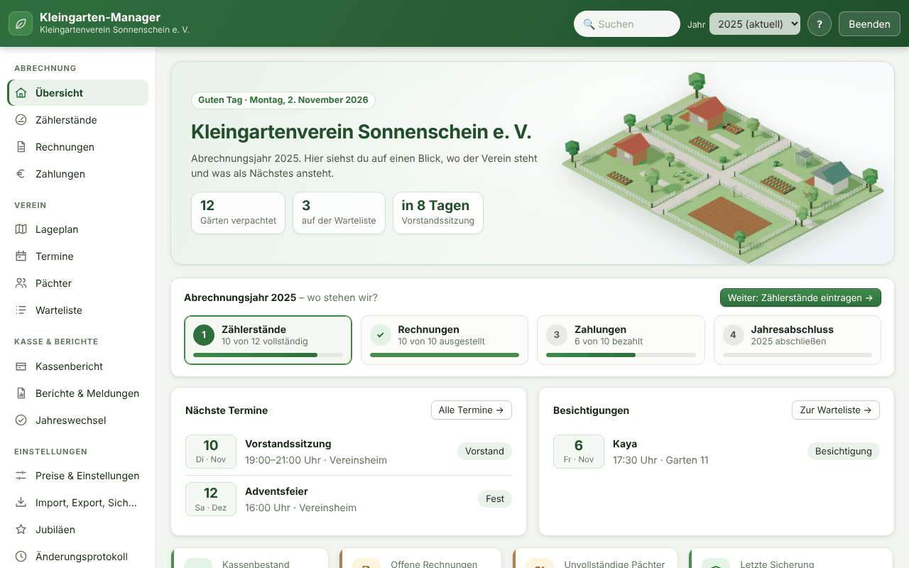
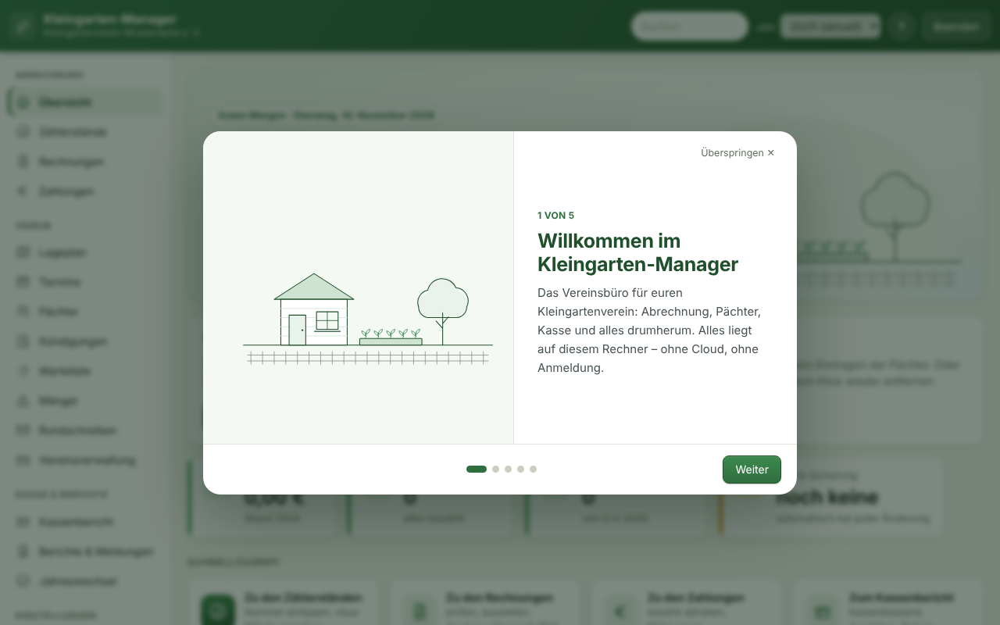
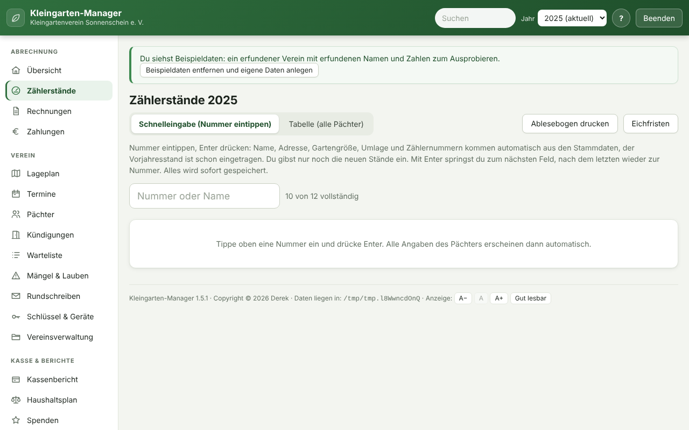
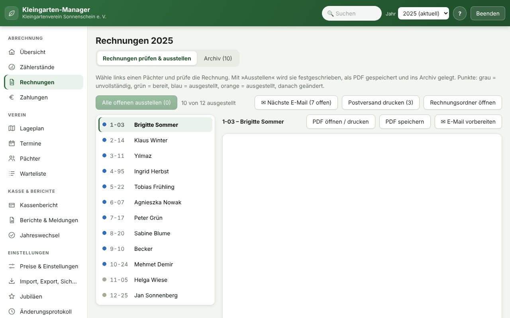
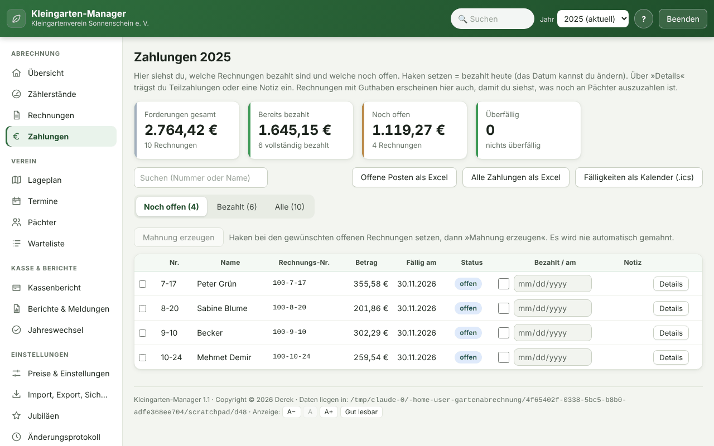
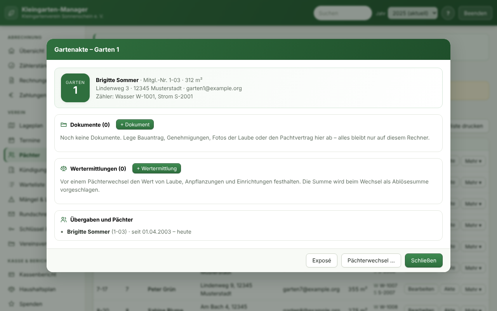
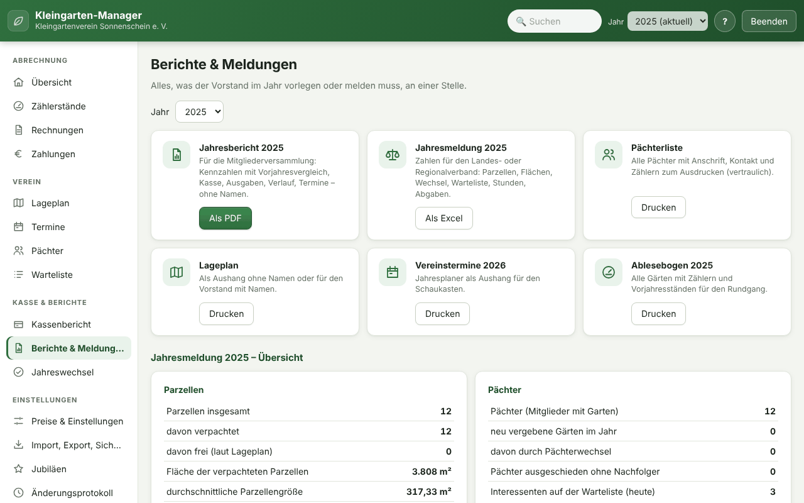
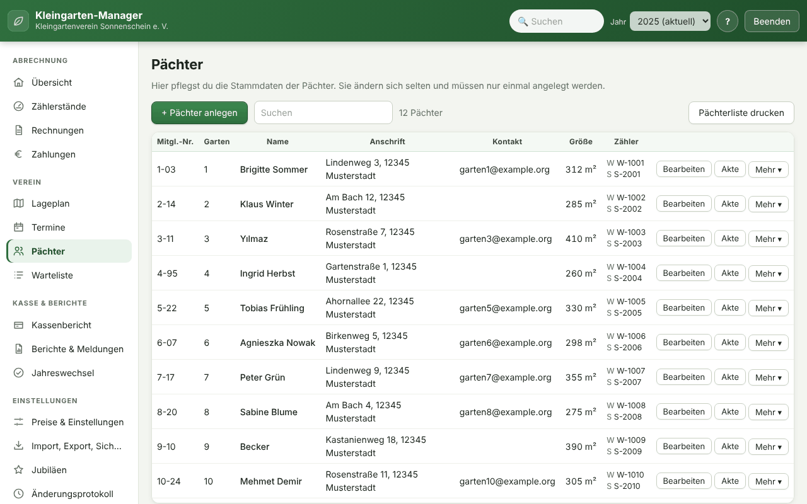
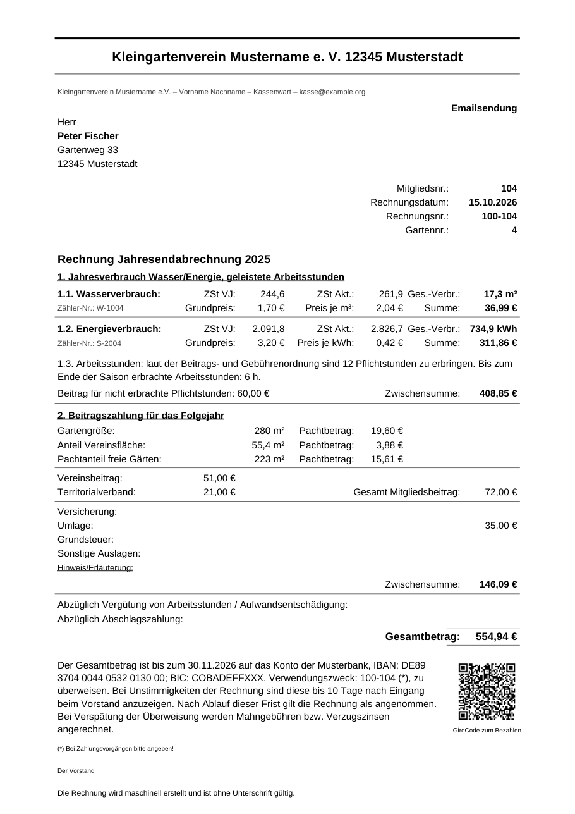

# Kleingarten-Manager

**Die Jahresabrechnung für euren Kleingartenverein.** Pächter einmal anlegen, jedes Jahr nur noch die
Zählerstände eintragen – die Rechnungen kommen fertig als PDF heraus, mit QR-Code zum Bezahlen.

### [⬇ Zum Download (Windows und macOS)](https://github.com/Magnethelm90/Kleingarten-Manager/releases/latest)

- **Kostenlos**, ohne Anmeldung und ohne Abo
- **Keine Installation:** eine Datei herunterladen und doppelklicken
- **Eure Daten bleiben bei euch:** alles liegt auf dem eigenen Rechner, nichts wird ins Internet gesendet
- **Für Vorstand und Kassenwart gemacht:** Zählerstände, Rechnungen, Zahlungen, Mahnungen, Kassenbericht,
  Pächterwechsel, Warteliste, Gartenakte, Termine und die Jahresmeldung an den Verband
- **Mit Einführung:** beim ersten Start zeigt ein kurzer Rundgang, was wohin gehört
- **Erst ausprobieren:** auf Knopfdruck mit einem erfundenen Beispielverein, der sich danach mit einem Klick wieder entfernen lässt

## So sieht es aus

| | |
| --- | --- |
|  |  |
| **Einführung** beim ersten Start – fünf kurze Schritte | **Zählerstände:** Nummer eintippen, nur die neuen Stände eingeben |
|  |  |
| **Rechnungen** prüfen und mit einem Klick für alle ausstellen | **Zahlungen** abhaken, offene Posten und Mahnungen |
|  |  |
| **Gartenakte:** Dokumente, Fotos, Wertermittlung und Verlauf je Garten | **Berichte & Meldungen:** Jahresbericht, Jahresmeldung für den Verband, Aushänge |
|  |  |
| **Pächter** einmal anlegen oder aus Excel übernehmen | **Die fertige Rechnung** als PDF, mit GiroCode zum Bezahlen |

Alle Namen und Zahlen in den Bildern sind erfunden.

## In drei Schritten zur ersten Rechnung

1. **Herunterladen und starten:** Die Datei aus dem [Download](https://github.com/Magnethelm90/Kleingarten-Manager/releases/latest)
   in einen eigenen Ordner legen und doppelklicken. Windows zeigt beim ersten Start eventuell
   „Der Computer wurde durch Windows geschützt“, weil das Programm nicht kostenpflichtig signiert ist:
   auf **Weitere Informationen → Trotzdem ausführen** klicken.
2. **Einrichten:** unter *Preise & Einstellungen* Verein, Preise und Bankverbindung eintragen und unter
   *Pächter* die Pächter anlegen (oder eine vorhandene Excel-Liste importieren).
3. **Abrechnen:** unter *Zählerstände* die neuen Stände eingeben, dann unter *Rechnungen* auf
   „Alle offenen ausstellen“ – fertig sind die PDFs zum Mailen oder Ausdrucken.

## Über das Programm

Der Kleingarten-Manager ist ein Programm für Windows und macOS. Er begann als reine Jahresabrechnung (früher hieß
er „Gartenabrechnung“) und deckt inzwischen den ganzen Vereinsalltag ab: von den Zählerständen über Kasse und
Pächterwechsel bis zur Meldung an den Verband.

Unter Windows ist es eine einzelne `.exe` ohne Installation, unter macOS eine `.app` für den Programme-Ordner.
Es öffnet ein eigenes Programmfenster. **Alle Daten bleiben auf eurem Rechner**: Es gibt keine Cloud, kein
Benutzerkonto und keine Übertragung ins Internet.

## Was das Programm kann

### Für den Vorstand

- **Was steht an?** Die Übersicht sagt von selbst, was zu tun ist: Ablesung oder Versammlung vorbereiten, Stunden nach
  dem Arbeitseinsatz eintragen, überfällige Zahlungen, abgelaufene Mängelfristen, Spenden ohne Bestätigung,
  ein bald ablaufender Bescheid zur Gemeinnützigkeit, Warteliste nachfragen
- **Amtsübergabe:** Die Vereinsakte enthält alle Daten und Dateien plus ein »Lies mich zuerst« mit Zahlen, Preisen,
  Terminen und offenen Punkten – auf einen USB-Stick kopieren und der neue Vorstand kann sofort weitermachen
- **Mehrere Vorstände ohne Cloud:** Liegt der Datenordner auf einem USB-Stick oder Netzlaufwerk, erkennt das Programm,
  wenn er gerade an einem anderen Rechner geöffnet ist, und verhindert, dass Änderungen überschrieben werden
- **Willkommensmappe** für neue Pächter (Garten, Zähler, Termine, Lageplan mit markiertem Garten, Ansprechpartner) und
  **Exposé** für freie Gärten (Foto, Größe, Ablöse, laufende Kosten, Lage) für Interessenten der Warteliste

### Abrechnung

- **Zählerstände** in der Schnelleingabe: Nummer eintippen, Name und Vorjahresstände erscheinen von selbst, nur die
  neuen Stände eingeben. Bei auffälligem Verbrauch (z. B. Tippfehler) kommt ein Hinweis. Ein Zählertausch während
  des Jahres wird richtig verrechnet.
- **Ablesebogen** zum Ausdrucken für den Rundgang, mit Zählernummern und Vorjahresständen
- **Zählerstand-Erinnerung:** zeigt, wer noch keinen Stand gemeldet hat, mit Aushang (nur Gartennummern) und
  vorbereiteter E-Mail an alle auf einmal
- **Rechnungen als PDF**, einzeln oder alle auf einmal, mit **GiroCode** zum Bezahlen per Banking-App. Ausgestellte
  Rechnungen werden festgeschrieben und archiviert, das Archiv lässt sich über alle Jahre durchsuchen.
- **Versand:** alle Rechnungen mit Postversand in einer Druckdatei; für die übrigen bereitet das Programm die
  E-Mail mit fertigem Text in eurem E-Mail-Programm vor (es verschickt selbst nichts)
- **Zahlungen:** bezahlt abhaken, Teilzahlungen, offene Posten, Mahnungen als PDF (nur die ausgewählten, nie
  automatisch), Fälligkeiten als Kalenderdatei, Excel-Export
- **Jahreswechsel** mit Checkliste: Zählerstände und Kassenbestand werden ins neue Jahr übernommen, abgeschlossene
  Jahre bleiben unverändert nachdruckbar

### Verein und Gärten

- **Pächter** anlegen oder aus einer Excel-/CSV-Liste übernehmen, mit Kontakt, Gartengröße, Zählern und interner
  Notiz; gelöschte Pächter kommen erst in den Papierkorb
- **Lageplan:** die Gärten so angeordnet, wie sie auf dem Gelände liegen, farbig nach Abrechnungsstand; freie
  Gärten gestrichelt, mit einem Klick an jemanden von der Warteliste vergeben; als Aushang druckbar (ohne Namen)
- **Gartenakte:** alles zu einem Garten an einer Stelle – Verlauf, Übergaben, Wertermittlungen und Dokumente wie
  Bauantrag, Genehmigung, Fotos der Laube oder Pachtvertrag
- **Pächterwechsel** in einem Schritt: Schlussrechnung für den bisherigen Pächter (nur Verbrauch bis zur Übergabe),
  der neue startet mit den Übergabeständen, dazu ein **Übergabeprotokoll** zum Unterschreiben
- **Wertermittlung** von Laube, Anpflanzungen und Einrichtungen mit Abschlag für Alter und Zustand; die Summe wird
  beim Wechsel als Ablösesumme vorgeschlagen
- **Warteliste** in der Reihenfolge der Anmeldung, mit Besichtigungsterminen und Erinnerung, lange nicht bestätigte
  Einträge nachzufragen
- **Mängel und Gartenbegehung:** Begehungsliste zum Ausdrucken, Mängel je Garten mit Frist erfassen und dem Pächter
  eine schriftliche Aufforderung als PDF schreiben; dazu die **Drittelregelung**: Flächenanteile schätzen und sehen,
  welche Gärten unter einem Drittel Anbau liegen
- **Vereinstermine:** Jahresplaner für Arbeitseinsätze, Versammlungen und Feste, als Aushang und als Kalenderdatei
  fürs Handy, mit einem Klick ins nächste Jahr übernommen; für Versammlungen gibt es die **Einladung mit
  Tagesordnung** und die **Anwesenheitsliste** zum Unterschreiben
- **Gemeinschaftsstunden aus Arbeitseinsätzen:** Stundenliste zum Ausdrucken, danach am Rechner abhaken, wer da
  war – die Stunden landen automatisch beim Pächter, Korrekturen zählen nicht doppelt
- **Jubiläen** langjähriger Mitglieder für die Mitgliederversammlung

### Kasse und Berichte

- **Kassenbericht** mit Anfangs- und Endbestand, Vorjahresvergleich, Verlauf über die Jahre und Vergleich mit der
  Rechnung des Versorgers; sonstige Ausgaben mit Kategorie und Beleg-Fotos, wiederkehrende Ausgaben werden
  vorgeschlagen; als Excel-Datei
- **Kontoauszug einlesen:** die CSV-Datei aus dem Online-Banking laden, das Programm ordnet die Eingänge über die
  Rechnungsnummer im Verwendungszweck den Rechnungen zu (sonst Vorschlag über Name und Betrag); übernommen wird nur, was
  du bestätigst, und nichts doppelt
- **Spenden und Zuwendungsbestätigungen** nach dem amtlichen Muster, einzeln oder als Sammelbestätigung fürs Jahr;
  das Programm prüft, ob der Bescheid des Finanzamts noch gilt, und zählt Spenden im Kassenbericht als Einnahme
- **Kassenprüfer-Zugang** mit eigenem Passwort: sieht den Kassenbericht und hakt Ausgaben als geprüft ab, sonst nichts
- **Jahresbericht** als PDF für die Mitgliederversammlung – Kennzahlen, Kasse, Diagramm, Termine, ohne Namen
- **Jahresmeldung** für den Landes- oder Regionalverband: Parzellen, Flächen, Wechsel, Warteliste,
  Gemeinschaftsstunden, Abgaben – als Übersicht und Excel-Datei

### Bedienung

- **Einführung** beim ersten Start und jederzeit über das »?«; **Beispieldaten** zum gefahrlosen Ausprobieren
- Übersicht mit Jahresfortschritt, nächsten Terminen und Kennzahlen; Suche nach Name, Garten oder Nummer von
  jeder Seite aus
- **Vereinsfarbe und Logo** für Programm und Rechnungen; Modus **»Gut lesbar«** und einstellbare Schriftgröße

### Sicherung und Datenschutz

- **Automatische Sicherungen** bei jeder Änderung, vor heiklen Schritten und vor jedem Jahreswechsel (zwölf Jahre
  lang), auf Wunsch zusätzlich auf einem USB-Stick oder Netzlaufwerk; jede Sicherung lässt sich wieder einspielen
- **DSGVO-Hilfen:** Auskunft je Person als Datei, endgültiges Löschen auch aus allen Sicherungen, Bereinigung nach
  Ablauf der Aufbewahrungsfrist, Änderungsprotokoll. Vorlagen für Verarbeitungsverzeichnis und
  Mitgliederinformation stehen in [DATENSCHUTZ.md](DATENSCHUTZ.md).

## Abrechnungsregeln

Alle Preise und Regeln stellt ihr unter *Preise & Einstellungen* selbst ein:

- Wasser und Strom: Grundpreis + Verbrauch × Preis
- Arbeitsstunden: unter den Pflichtstunden wird nachberechnet, darüber bis zu einer Obergrenze vergütet
- Pacht: Gartenfläche × Preis je m², dazu Anteile für Vereinsfläche und freie Gärten; außerdem Mitgliedsbeitrag
  und Umlage
- Gesamtbetrag = Kosten + Pacht und Beiträge − Vergütung − Abschlag (negativ = Guthaben)

## Starten

### Windows

`Kleingarten-Manager.exe` in einen eigenen Ordner legen und doppelklicken. Weil die Datei nicht mit einem
kostenpflichtigen Zertifikat signiert ist, warnt Windows beim ersten Start eventuell („Der Computer wurde durch
Windows geschützt“): **Weitere Informationen → Trotzdem ausführen**. Danach startet das Programm ohne Rückfrage.
Das Programmfenster nutzt WebView2, das Windows 10 und 11 mitbringen.

Die Daten liegen im selben Ordner wie die `.exe`:

| Datei / Ordner | Inhalt |
| --- | --- |
| `kleingarten-manager-daten.json` | alle Daten: Pächter, Zählerstände, Rechnungsarchiv, Zahlungen, Termine, … |
| `Rechnungen/<Jahr>/` | die ausgestellten Rechnungen als PDF |
| `Belege/`, `Gartenakte/`, `Logo/` | hochgeladene Belege, Dokumente und das Vereinslogo |
| `Sicherungen/` | automatische Sicherungen |
| `Druck/` | kurzlebige Druckdateien, wird beim Start geleert |

Zum Umziehen auf einen anderen Rechner einfach den ganzen Ordner kopieren.

### macOS

`Kleingarten-Manager.app` in den Programme-Ordner ziehen (läuft auf Apple Silicon und Intel). Beim allerersten
Start meldet macOS „nicht verifizierter Entwickler“: mit Rechtsklick auf die App → **Öffnen** → nochmals
**Öffnen**. Danach startet sie normal per Doppelklick. Die Daten liegen unter
`~/Library/Application Support/Kleingarten-Manager/`.

### Gut zu wissen

- **Passwort vergessen?** Das Programm einmal mit `--reset-admin` starten (Windows: in der Eingabeaufforderung
  `Kleingarten-Manager.exe --reset-admin`), dann ist der Passwortschutz entfernt.
- Weitere Startoptionen: `--data <Ordner>` (anderer Datenordner), `--port <Zahl>`, `--no-browser` (ohne Fenster,
  nur im Hintergrund, Zugriff über den Browser).
- Wer von der alten „Gartenabrechnung“ kommt: Die vorhandenen Daten werden beim ersten Start automatisch übernommen.

## Sicherheit

- Das Programm ist **nur auf dem eigenen Rechner** erreichbar, nicht aus dem Netzwerk oder dem Internet.
- Die **Verwaltung** (Pächter, Warteliste, Kasse, Berichte, Einstellungen) lässt sich mit einem Passwort schützen.
  Übersicht, Zählerstände, Rechnungen, Zahlungen, Lageplan und Termine bleiben für alle am Rechner offen, damit
  zum Beispiel beim Ablesen jemand helfen kann.
- Wer sich am Rechner anmelden kann, kommt auch an die Datendatei. Sie ist nicht verschlüsselt. Deshalb gehört
  das Programm auf einen Rechner mit eigenem Benutzerkennwort und eingeschalteter Festplattenverschlüsselung
  (Windows: BitLocker bzw. Geräteverschlüsselung, macOS: FileVault).
- Das Programm sendet nichts ins Internet. Nur »Nach Updates suchen« fragt auf Knopfdruck bei GitHub nach einer
  neuen Version.

Sicherheitslücken bitte nicht öffentlich melden, sondern direkt an den Autor.

## Für Entwickler

Wie man das Programm selbst baut, testet und eine neue Version veröffentlicht, steht in
[ENTWICKLUNG.md](ENTWICKLUNG.md), ebenso die technischen Details zur Sicherheit.

## Verwendete Bestandteile

- [go-pdf/fpdf](https://github.com/go-pdf/fpdf) (MIT) für die PDF-Erzeugung
- [skip2/go-qrcode](https://github.com/skip2/go-qrcode) (MIT) für den GiroCode auf der Rechnung
- [webview/webview_go](https://github.com/webview/webview_go) (MIT) für das Programmfenster
- Liberation Sans (SIL Open Font License, siehe `fonts/LICENSE-Liberation.txt`) als eingebettete Schrift

Copyright © Derek
